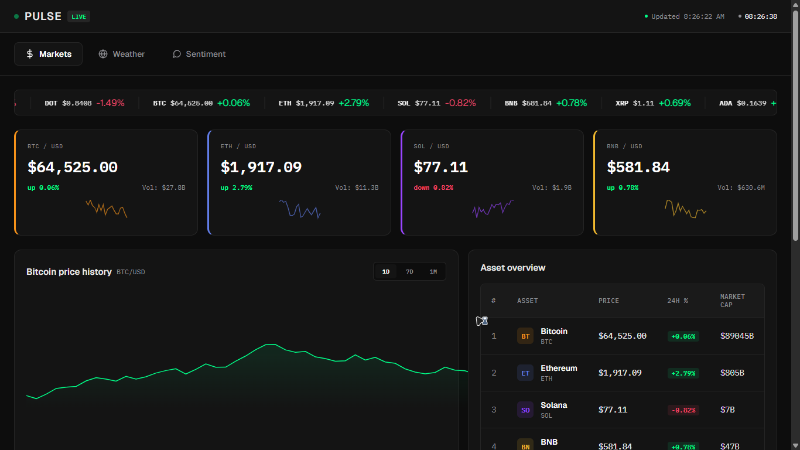
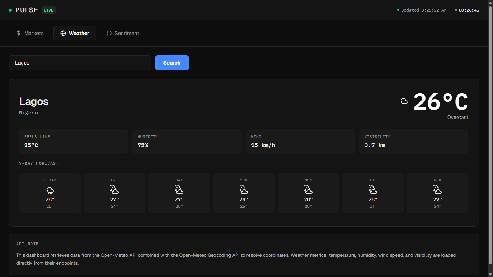

# Pulse Dashboard

A responsive real-time dashboard showing cryptocurrency markets, weather, and market sentiment. Built with vanilla HTML, CSS, and JavaScript.





## What it does

- Shows live crypto prices and charts from CoinGecko API
- Look up weather for any city with Open-Meteo API
- Displays market sentiment gauge
- Tab navigation between Markets, Weather, and Sentiment
- Charts update based on time period (1D, 7D, 1M)
- Local storage caching to avoid hitting API rate limits

## Technologies

- HTML5 with ARIA roles for accessibility
- CSS3 with CSS Grid, custom properties, responsive design
- Vanilla JavaScript (ES6+)
- CoinGecko API
- Open-Meteo API
- Alternative.me Fear & Greed Index

## Key Features

- Real-time data feeds with error handling and fallbacks
- Accessible tab interface with keyboard navigation
- Responsive design works on mobile, tablet, and desktop
- SVG weather icons render dynamically based on conditions
- Smart caching prevents unnecessary API calls

## Project Structure

```
pulse-dashboard/
├── index.html
├── css/dashboard.css
├── js/app.js
└── assets/
    └── screenshots/
        ├── home.png
        └── feature.png
```

## Setup

1. Clone or download this folder
2. Open `index.html` in a browser
3. Need internet connection for live data

## Browser Support

Tested in current versions of Chrome, Edge, Firefox, and Safari.
